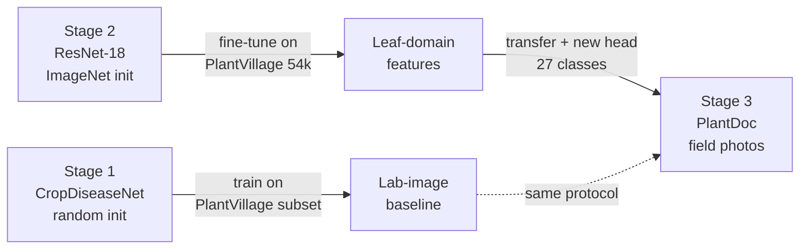

# Crop Disease Classification — Custom CNN + Transfer Learning


A three-stage image-classification pipeline for plant disease detection. It trains a
custom CNN from scratch, then builds a domain-specific feature extractor, then transfers
those features onto hard real-world field photographs — and reports the difference.

The point is not a single accuracy number. It is the **experiment design**: a defensible
comparison between a from-scratch model and a transfer-learned one, with the data-leakage
traps that usually invalidate such comparisons explicitly handled.

---

## Pipeline



| Stage | Model | Training data | Purpose |
|---|---|---|---|
| `scratch` | CropDiseaseNet (1.2 M params) | PlantVillage subset, ~3.6 k | Proves the custom architecture learns |
| `pretrain` | ResNet-18 (ImageNet init) | PlantVillage, 54 k / 38 classes | Builds leaf-domain features |
| `finetune` | ResNet-18 (warm-started) | PlantDoc, 2.6 k / 27 classes | The headline result |

---

## Expected results

Reproduce with the stages below. Ranges reflect comparable setups — run it for your own numbers.

| # | Model | Trained on | Evaluated on | Expected accuracy |
|---|---|---|---|---|
| A | CropDiseaseNet, scratch | PlantVillage subset | held-out 20 % | 95–97 % |
| B | ResNet-18, ImageNet init | PlantDoc only | PlantDoc test | 83–86 % |
| C | ResNet-18, PlantVillage-pretrained | PlantVillage + PlantDoc | PlantDoc test | **88–92 %** |
| D | CropDiseaseNet, PlantVillage-pretrained | PlantVillage subset + PlantDoc | PlantDoc test | 70–78 % |

**Row A is the important one.** PlantVillage is lab photography: single leaf, uniform
background, controlled light. PlantDoc is a phone photo of a real plant with soil, shadow
and clutter. A from-scratch model on ~96 images per class fails on row A's data when moved
to the field — that failure is the justification for rows B–D, and it is why this repo
exists rather than just shipping one high number.

Row D is a useful ablation: even a small custom CNN benefits from domain pretraining, so
the gain is not specific to ResNet.

> Note on PlantVillage: it saturates at 98–99 %. That number is easy and largely meaningless
> on its own. The stage exists to produce features, not a headline. Judge the project on the
> PlantDoc column.

---

## Datasets

| Dataset | Images | Classes | Source |
|---|---|---|---|
| [PlantVillage](https://github.com/spMohanty/PlantVillage-Dataset) | 54,306 | 38 (14 crops) | Lab imagery, uniform background |
| [PlantDoc](https://github.com/pratikkayal/PlantDoc-Dataset) | 2,598 | 27 (13 species) | Real field photos, official train/test split |

Both expected under one root:

```
D:\AI\DATASET\                       # override with CNN_DATASET_DIR
├── PlantVillage-Dataset\color\       # flat: Crop___Disease/*.JPG
├── PlantDoc-Dataset\
│   ├── train\<class>\*.jpg
│   └── test\<class>\*.jpg
└── PlantVillage_3Crops\              # generated by prepare_datasets.py subset
    └── <Crop>\<Disease>\*.jpg
```

```bash
cd D:\AI\DATASET
git clone https://github.com/spMohanty/PlantVillage-Dataset
git clone https://github.com/pratikkayal/PlantDoc-Dataset
```

---

## Quickstart

```bash
pip install -r requirements.txt

# 1. build a small, balanced subset for the from-scratch stage
python prepare_datasets.py subset \
  --src D:\AI\DATASET\PlantVillage-Dataset\color \
  --dst D:\AI\DATASET\PlantVillage_3Crops \
  --crops Potato,Corn,Pepper_bell --max-per-class 400

# 2. verify quantities before spending GPU time
python prepare_datasets.py verify --root D:\AI\DATASET\PlantVillage_3Crops
python prepare_datasets.py verify --root D:\AI\DATASET\PlantDoc-Dataset

# 3. train the three stages, in order
python train.py --stage scratch
python train.py --stage pretrain
python train.py --stage finetune

# 4. evaluate and build the report
python evaluate.py --stage finetune
python report.py --open
```

Any stage can be re-pointed without editing source:

```bash
python train.py --stage finetune --dataset D:\other\PlantDoc --epochs 15 --arch efficientnet_b0
```

---

## Project structure

```
config.py             Stage presets; per-stage output dirs; --stage / CNN_STAGE
dataset.py            Layout detection, indexing, splitting, loaders, statistics
model.py              CropDiseaseNet + TransferModel(9 backbones) + freeze/warm-start
train.py              Stage-aware loop: 2-phase fine-tune, AMP, early stopping
evaluate.py           Per-class report, confusion matrix, training curves
prepare_datasets.py   Dataset adapter (`subset`) and profiler (`verify`)
report.py             Self-contained HTML review pack
checkpoints/<stage>/  best_model.pth, class_mapping.json
logs/<stage>/         training_log.csv, summary.json, reports
reports/              review_pack.html, PNG charts, dataset CSVs
```

> The git root is the inner `CUSTOM-CNN-MODEL-main/CUSTOM-CNN-MODEL-main` folder.

---

## Design decisions

These are the choices that took the longest, each made for a specific failure mode.

**Split before you augment.** An offline-augmented dataset randomly split will place
augmented variants of the *same leaf* in both train and validation. The result is a
10–15 point accuracy inflation that survives until someone asks how the split was made.
This repo reuses a dataset's official train/test split when one exists, and warns loudly
when a path looks pre-augmented.

**Label format is a contract.** Nested (`Crop/Disease/`), flat (`ClassName/`) and
pre-split layouts are all normalised to one `"Crop - Disease"` schema, so downstream
reporting never has to know which dataset it is looking at.

**Freeze the head before the backbone.** Two-phase fine-tuning: the classifier trains alone
for a few epochs, then the backbone unfreezes at a much lower LR. Unfreezing a pretrained
backbone at a high LR destroys its filters within one epoch — on 2.6 k images it will never
recover.

**Frozen BatchNorm must be in `eval()`.** A frozen backbone left in `train()` mode keeps
updating its running mean/variance on the new dataset, silently corrupting the very
features you are trying to preserve.

**Initialise, then load — in that order.** Weight initialisation that runs unconditionally
in `__init__` overwrites pretrained weights if the load happens to miss keys. Callers that
intend to warm-start now pass `init_weights=False`.

**Per-stage outputs.** One `best_model.pth` shared across stages means stage 2 deletes
stage 1 and the comparison becomes impossible. Each stage owns `checkpoints/<stage>/`.

**One scheduler, not two.** A separate warm-up helper stepping alongside `StepLR`
desynchronises the schedule. A single `LambdaLR` handles warm-up plus cosine or step decay.

---

## Competencies demonstrated

Mapped to the responsibilities of a data-science / analytics role.

### 1. Data preprocessing — translating messy inputs into scalable structure

- `dataset.py` **auto-detects three incompatible on-disk layouts** and normalises them into
  one label schema, so the trainer is dataset-agnostic: swapping PlantDoc for a different
  corpus requires zero code changes.
- Builds a single index (path → class → crop) once, then derives splits, class weights and
  statistics from it, rather than re-walking the tree per epoch.
- `prepare_datasets.py verify` profiles any dataset before a training run: per-class counts,
  train/val split sizes, min/max class, imbalance ratio, mean per class. It then
  **interprets** the numbers — flags under 60 images/class as "from-scratch will overfit",
  flags imbalance beyond 5×, and detects pre-augmentation split leakage.
- Outputs to CSV + PNG so the profile can be attached to a review instead of living in a
  terminal scrollback.

### 2. Visual reporting — consolidating and sharing

- `report.py` produces a **single self-contained HTML review pack** (images embedded as
  base64, so it can be emailed or attached without a folder of loose files).
- Contents: KPI cards (stages completed, best accuracy, total training images, compute
  time), a stage-comparison table, per-stage run quantities, training curves, full
  classification reports and class-distribution charts.
- Emits a **markdown table** alongside the console scorecard, ready to paste into a slide
  or report.
- Every metric is labelled with the split it came from, and the report states explicitly
  that accuracies across stages are **not** directly comparable.

### 3. Building and reviewing models

- A custom CNN (`CropDiseaseNet`: 4 conv blocks, global average pooling, 1.2 M params) built
  from first principles, alongside wrappers for **9 torchvision backbones**.
- Three-stage training protocol producing a **controlled comparison** (scratch vs ImageNet
  init vs domain-pretrained) plus an ablation on architecture.
- Regularisation is deliberate and layered: label smoothing, dropout, class-balanced
  sampling, augmentation, early stopping, weight decay.
- Mixed-precision training with a gradient scaler for throughput.

### 4. Problem-solving — diagnosing rather than guessing

Each of the following was found by reading behaviour, not by grid-searching:

| Symptom | Root cause | Fix |
|---|---|---|
| Validation accuracy implausibly high | Augmented copies split across train/val | Reuse official split; warn on pre-augmented paths |
| Fine-tuned model worse than scratch | `lr=1e-3` on pretrained blocks | Discriminative LR, head 3e-4 / backbone 1e-5 |
| Transfer gains evaporate after epoch 1 | Frozen BatchNorm drifting | Hold frozen BN in `eval()` |
| Warm start silently ineffective | `_init_weights()` overwriting loaded weights | Gate init behind a flag |
| Stage 2 output overwrote stage 1 | Single shared checkpoint path | Per-stage output directories |
| LR schedule drifted from the epoch count | Warm-up helper stepping alongside `StepLR` | Single `LambdaLR` |

### 5. Project lifecycle ownership

- Reproducible by construction: seeded splits, config-driven hyperparameters, one command
  per stage.
- Every run writes `summary.json` — architecture, dataset, split type, class count, best
  epoch, metrics, wall-clock — so a result can be reconstructed without rerunning.
- Checkpoints carry their own metadata (architecture, image size, class mapping), so
  evaluation can never silently drift from training.
- Windows-safe defaults (`num_workers=0`, `__main__` guard) so the pipeline runs on the
  same laptop it was written on.

> **Domain note.** This project is agricultural computer vision. The preprocessing,
> modelling, reporting and diagnostic competencies above are domain-transferable; no
> supply-chain or product-configuration domain experience is claimed here.

---

## Limitations

- PlantVillage is lab imagery; strong results there do not imply field robustness.
- PlantDoc is small (2.6 k) and imbalanced. Top-1 accuracy hides weak minority classes —
  read the per-class F1, not just the aggregate.
- Crop-level grouping in `evaluate.py` assumes the `"Crop - Disease"` label convention.
- No object detection: one leaf per frame is assumed.

## Tech stack

Python · PyTorch · torchvision · scikit-learn · matplotlib · Pillow · tqdm

---

**Author** — Anandhasasidharan
